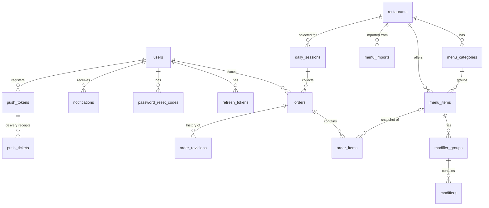

# Database

PostgreSQL 17, managed with Alembic (`backend/alembic/versions/0001_initial_schema.py`). All primary keys are UUIDs; all timestamps are `timestamptz` (UTC); money is `numeric(10,2)`.

```bash
cd backend && .venv/bin/alembic upgrade head                 # local
docker compose exec api alembic upgrade head                 # production (also runs on API start)
.venv/bin/alembic revision --autogenerate -m "describe change"   # after changing models
```

## Entity relationships



## Tables

| Table | Purpose / notable columns |
| --- | --- |
| `users` | Employees and admins. `username` unique, `lower(email)` unique, `role` (ADMIN/EMPLOYEE), `is_active`, `participates_in_orders`, `must_change_password`, lockout counters, `notification_prefs` (JSONB), `preferred_language` |
| `refresh_tokens` | SHA-256 of opaque refresh tokens, `family_id` for reuse detection, `revoked_at`, `replaced_by_id` |
| `password_reset_codes` | One-time hashed reset codes (30 min), attempt counter |
| `restaurants` | Directory: name, branch, cuisine, description, phone, address, logo/cover URLs, `source_provider` (MANUAL/FILE_IMPORT/TALABAT), optional authorized `external_reference`, `last_synced_at`, `is_active` |
| `menu_categories`, `menu_items` | Menu; `is_archived` instead of deletion; `menu_items.base_price ≥ 0` |
| `modifier_groups`, `modifiers` | Option groups with `minimum_selections ≤ maximum_selections`, `is_required`; per-option `additional_price ≥ 0`, `is_available` |
| `menu_imports` | Each uploaded file: type, SHA-256 (duplicate detection), status (PROCESSING/NEEDS_REVIEW/APPROVED/REJECTED/FAILED), editable `extraction_result` draft (JSONB), warnings, approval mode, stats. Never deleted (import history). |
| `daily_sessions` | One ordering day: `session_date` (Cairo), `restaurant_id`, `opens_at`, `closes_at` (> opens_at), status (DRAFT/OPEN/CLOSED/FINALIZED/CANCELLED), admin-entered `delivery_fee`/`service_fee`/`fee_note`/`fee_allocation`, lifecycle timestamps, `participants_snapshot` |
| `orders` | One per employee per session: human `reference`, status (SUBMITTED/CANCELLED), `total_amount`, `item_count`, `revision`, cancellation info |
| `order_items` | Immutable snapshots: item and category names, base and unit price, selected modifiers (JSONB), special instructions, `line_total`, `config_key` (item + modifier set, for grouping) |
| `order_revisions` | Full snapshot per change: CREATED, UPDATED, CANCELLED, ADMIN_CREATED, ADMIN_MODIFIED, ADMIN_CANCELLED, SESSION_CANCELLED |
| `idempotency_keys` | (user, key) → stored response for safe retries (cleaned after 3 days) |
| `notifications` | In-app notifications; unique nullable `dedupe_key`; `push_status` |
| `push_tokens`, `push_tickets` | Expo push tokens per device; tickets awaiting receipt checks |
| `audit_logs` | Actor, entity, action, previous/new JSON, reason |
| `app_settings` | Company settings (JSONB): cancellation policy, default times, reminder minutes, default fee split |

## Key constraints

- `uq_daily_sessions_active_date` — `UNIQUE (session_date) WHERE status <> 'CANCELLED'`
- `uq_orders_active_employee_session` — `UNIQUE (session_id, employee_id) WHERE status <> 'CANCELLED'`
- `uq_order_revisions_order_revision` — `UNIQUE (order_id, revision_no)`
- `uq_idempotency_keys_user_key` — `UNIQUE (user_id, key)`
- CHECK constraints on every status enum, quantities (1–50), non-negative prices and fees, `closes_at > opens_at`, modifier min/max.
- `order_items.menu_item_id` is `ON DELETE SET NULL` — history stays readable from snapshots even if a menu item row is ever removed.

## Backups

See [deployment.md](deployment.md#backups) for a nightly `pg_dump` cron example.
